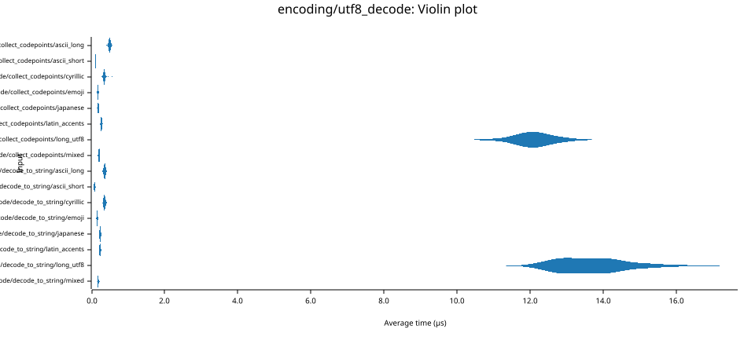
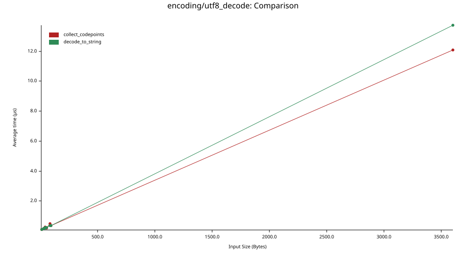
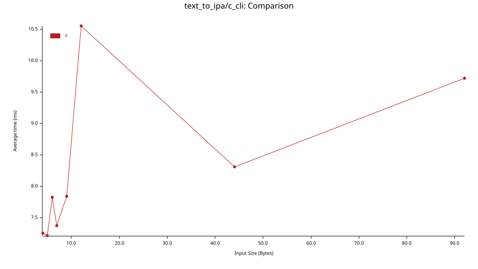
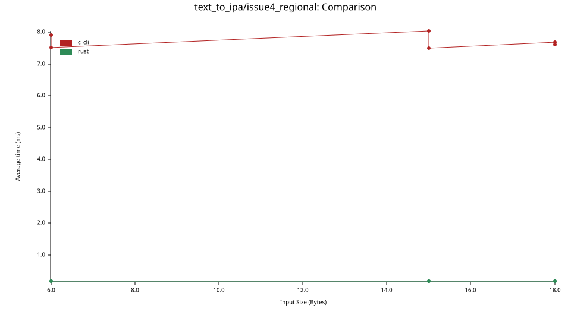
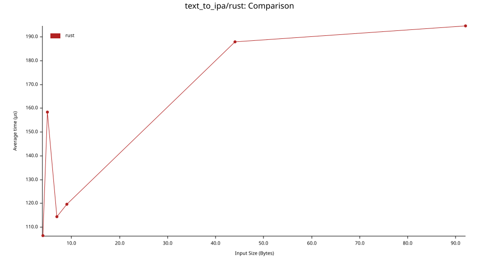

# Benchmark Results

Generated: 2026-05-11 18:46 UTC  
Platform: `Darwin 25.4.0 arm64`  
Rust: `rustc 1.95.0 (59807616e 2026-04-14)`  
eSpeak NG: `not installed`

> **Reading this file**  
> Times are wall-clock per operation (lower is better).  
> Throughput is input bytes or elements processed per second (higher is better).  
> **Rust** rows show the pure-Rust implementation; rows marked **c\_cli** call
> the `espeak-ng` binary as a subprocess (includes process-spawn overhead).  
> During the stub phase, Rust `text_to_ipa` rows measure error-path overhead
> only and will be replaced by real numbers as each module is implemented.

---

## encoding/name_lookup

| Function | Input           | Mean      | ±Std       |
| -------- | --------------- | --------- | ---------- |
| rust     |                 | 1.610 ns  | ±0.133 ns  |
| rust     | ISO-10646-UCS-2 | 22.727 ns | ±1.526 ns  |
| rust     | ISO-8859-1      | 18.758 ns | ±1.499 ns  |
| rust     | ISO-8859-15     | 32.735 ns | ±18.391 ns |
| rust     | KOI8-R          | 22.237 ns | ±1.304 ns  |
| rust     | US-ASCII        | 17.717 ns | ±1.171 ns  |
| rust     | UTF-8           | 20.281 ns | ±1.329 ns  |
| rust     | bogus           | 20.444 ns | ±1.352 ns  |


## encoding/utf8_decode

| Function           | Input         | Mean       | ±Std        | Throughput  |
| ------------------ | ------------- | ---------- | ----------- | ----------- |
| collect_codepoints | ascii_long    | 493.284 ns | ±24.208 ns  | 172.31 MB/s |
| collect_codepoints | ascii_short   | 109.960 ns | ±4.332 ns   | 100.04 MB/s |
| collect_codepoints | cyrillic      | 346.947 ns | ±31.471 ns  | 265.17 MB/s |
| collect_codepoints | emoji         | 171.084 ns | ±10.120 ns  | 169.51 MB/s |
| collect_codepoints | japanese      | 180.726 ns | ±10.949 ns  | 315.39 MB/s |
| collect_codepoints | latin_accents | 267.882 ns | ±13.000 ns  | 164.25 MB/s |
| collect_codepoints | long_utf8     | 12.073 µs  | ±601.451 ns | 298.18 MB/s |
| collect_codepoints | mixed         | 203.463 ns | ±12.622 ns  | 196.60 MB/s |
| decode_to_string   | ascii_long    | 357.854 ns | ±22.190 ns  | 237.53 MB/s |
| decode_to_string   | ascii_short   | 82.791 ns  | ±17.865 ns  | 132.86 MB/s |
| decode_to_string   | cyrillic      | 352.709 ns | ±21.861 ns  | 260.84 MB/s |
| decode_to_string   | emoji         | 153.720 ns | ±9.535 ns   | 188.65 MB/s |
| decode_to_string   | japanese      | 234.083 ns | ±13.467 ns  | 243.50 MB/s |
| decode_to_string   | latin_accents | 230.392 ns | ±13.712 ns  | 190.98 MB/s |
| decode_to_string   | long_utf8     | 13.725 µs  | ±954.861 ns | 262.29 MB/s |
| decode_to_string   | mixed         | 179.639 ns | ±10.555 ns  | 222.67 MB/s |
| rust               | ascii_long    | 308.117 ns | ±4.440 ns   | 275.87 MB/s |
| rust               | ascii_short   | 69.380 ns  | ±3.395 ns   | 158.55 MB/s |
| rust               | cyrillic      | 333.824 ns | ±9.683 ns   | 275.59 MB/s |
| rust               | emoji         | 126.940 ns | ±3.792 ns   | 228.46 MB/s |
| rust               | japanese      | 215.162 ns | ±4.580 ns   | 264.92 MB/s |
| rust               | latin_accents | 202.892 ns | ±4.824 ns   | 216.86 MB/s |
| rust               | long_utf8     | 11.999 µs  | ±1.101 µs   | 300.02 MB/s |
| rust               | mixed         | 168.322 ns | ±8.471 ns   | 237.64 MB/s |
| rust_iter          | ascii_long    | 431.171 ns | ±7.369 ns   | 197.14 MB/s |
| rust_iter          | ascii_short   | 102.034 ns | ±1.641 ns   | 107.81 MB/s |
| rust_iter          | cyrillic      | 320.650 ns | ±5.459 ns   | 286.92 MB/s |
| rust_iter          | emoji         | 183.411 ns | ±46.306 ns  | 158.11 MB/s |
| rust_iter          | japanese      | 209.330 ns | ±54.539 ns  | 272.30 MB/s |
| rust_iter          | latin_accents | 248.284 ns | ±4.837 ns   | 177.22 MB/s |
| rust_iter          | long_utf8     | 12.373 µs  | ±545.641 ns | 290.95 MB/s |
| rust_iter          | mixed         | 200.809 ns | ±19.578 ns  | 199.19 MB/s |




## latency/first_phoneme

| Function | Input          | Mean       | ±Std        |
| -------- | -------------- | ---------- | ----------- |
| c_cli    | de/guten       | 10.121 ms  | ±2.490 ms   |
| c_cli    | en/hello       | 7.877 ms   | ±339.980 µs |
| c_cli    | en/hello_world | 7.324 ms   | ±251.499 µs |
| c_cli    | en/hi          | 7.601 ms   | ±385.818 µs |
| c_cli    | fr/bonjour     | 7.182 ms   | ±176.461 µs |
| rust     | de/guten       | 129.998 µs | ±2.594 µs   |
| rust     | en/hello       | 150.481 µs | ±4.226 µs   |
| rust     | en/hello_world | 152.364 µs | ±4.634 µs   |
| rust     | en/hi          | 171.770 µs | ±24.406 µs  |
| rust     | fr/bonjour     | 112.122 µs | ±2.932 µs   |


## synthesize/resonator

| Function                | Mean       | ±Std      | Throughput       |
| ----------------------- | ---------- | --------- | ---------------- |
| tick_64_samples         | 134.007 ns | ±6.699 ns | -                |
| tick_one_second_22050hz | 52.589 µs  | ±2.373 µs | 419287724 elem/s |
| tick_single             | 2.352 ns   | ±0.139 ns | -                |


## text_to_ipa/c_cli

| Function | Input        | Mean      | ±Std        | Throughput |
| -------- | ------------ | --------- | ----------- | ---------- |
| c        | de/word      | 7.842 ms  | ±981.042 µs | 1.15 KB/s  |
| c        | en/paragraph | 9.724 ms  | ±390.674 µs | 9.46 KB/s  |
| c        | en/sentence  | 8.307 ms  | ±296.527 µs | 5.30 KB/s  |
| c        | en/word      | 7.211 ms  | ±223.763 µs | 0.69 KB/s  |
| c        | es/word      | 7.256 ms  | ±311.176 µs | 0.55 KB/s  |
| c        | fr/word      | 7.371 ms  | ±193.100 µs | 0.95 KB/s  |
| c        | ru/word      | 10.549 ms | ±1.380 ms   | 1.14 KB/s  |
| c        | zh/word      | 7.826 ms  | ±359.420 µs | 0.77 KB/s  |




## text_to_ipa/issue4_regional

| Function | Input                    | Mean       | ±Std        | Throughput  |
| -------- | ------------------------ | ---------- | ----------- | ----------- |
| c_cli    | en-rp/When_choices_cease | 7.681 ms   | ±352.004 µs | 2.34 KB/s   |
| c_cli    | en-rp/seen_or_unseen_    | 8.035 ms   | ±293.976 µs | 1.87 KB/s   |
| c_cli    | en-rp/unseen             | 7.913 ms   | ±469.640 µs | 0.76 KB/s   |
| c_cli    | en-us/When_choices_cease | 7.606 ms   | ±382.586 µs | 2.37 KB/s   |
| c_cli    | en-us/seen_or_unseen_    | 7.496 ms   | ±235.074 µs | 2.00 KB/s   |
| c_cli    | en-us/unseen             | 7.519 ms   | ±132.593 µs | 0.80 KB/s   |
| rust     | en-rp/When_choices_cease | 166.121 µs | ±4.135 µs   | 108.35 KB/s |
| rust     | en-rp/seen_or_unseen_    | 170.693 µs | ±6.793 µs   | 87.88 KB/s  |
| rust     | en-rp/unseen             | 169.943 µs | ±13.216 µs  | 35.31 KB/s  |
| rust     | en-us/When_choices_cease | 170.975 µs | ±5.316 µs   | 105.28 KB/s |
| rust     | en-us/seen_or_unseen_    | 164.209 µs | ±3.967 µs   | 91.35 KB/s  |
| rust     | en-us/unseen             | 159.495 µs | ±3.535 µs   | 37.62 KB/s  |




## text_to_ipa/rust

| Function | Input        | Mean       | ±Std       | Throughput  |
| -------- | ------------ | ---------- | ---------- | ----------- |
| rust     | de/word      | 119.708 µs | ±5.433 µs  | 75.18 KB/s  |
| rust     | en/paragraph | 194.558 µs | ±10.604 µs | 472.87 KB/s |
| rust     | en/sentence  | 187.870 µs | ±8.541 µs  | 234.20 KB/s |
| rust     | en/word      | 158.344 µs | ±6.929 µs  | 31.58 KB/s  |
| rust     | es/word      | 106.377 µs | ±5.846 µs  | 37.60 KB/s  |
| rust     | fr/word      | 114.386 µs | ±5.420 µs  | 61.20 KB/s  |




---

## Notes

- Times are [criterion](https://github.com/bheisler/criterion.rs) means over
  100 samples (15 for CLI subprocess groups).
- **c\_cli** benchmarks include subprocess spawn + espeak-ng initialisation +
  data file loading on every call — this is the real-world latency a caller
  would see when shelling out to `espeak-ng`.
- The **bundled-espeak** feature (`cargo bench --features bundled-espeak`)
  downloads and compiles espeak-ng from source so the C baseline runs even
  without a system installation.
- Once the Rust `translate` module is implemented, the **rust** rows in the
  `text_to_ipa` groups will reflect actual pipeline performance.
- Charts are Criterion's SVG output copied into `benches/results/` so they
  render directly in GitHub without needing `target/` to be checked in.

## Re-running

```bash
# Using system espeak-ng (must be on PATH)
./benches/bench.sh

# Building espeak-ng from source automatically
./benches/bench.sh --bundled

# Only encoding benchmarks
./benches/bench.sh --filter encoding

# Parse existing results without re-running
./benches/bench.sh --no-run
```
